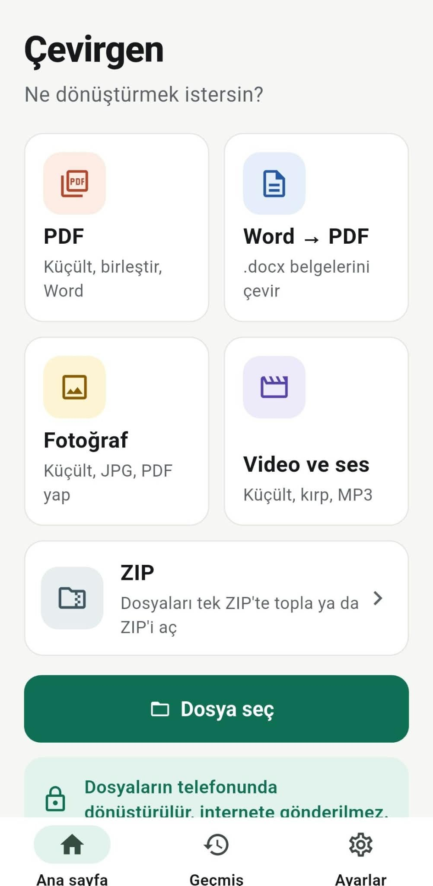
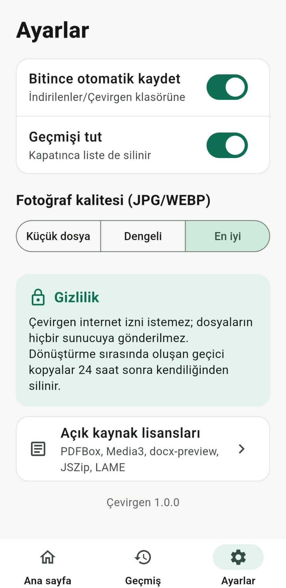

# Çevirgen

İnternete hiç bağlanmadan, tamamen telefonda çalışan bir dosya dönüştürme uygulaması. PDF, Word, fotoğraf, video, ses ve ZIP işlemlerini tek bir yerde toplar.

<p align="center">
  
  &nbsp;&nbsp;
  
</p>

## Özellikler

- **PDF:** birleştirme, sayfalara ayırma, istenen sayfaları seçip sıralama, ilk/son sayfayı silme
- **Fotoğraflardan PDF:** birden çok fotoğrafı tek bir PDF'te toplama
- **PDF → Word:** yazıları ve başlıkları düzenlenebilir `.docx` belgesine aktarma; taranmış sayfalar cihaz üzerinde çalışan metin tanıma (OCR) ile okunur
- **Word → PDF:** `.docx` belgelerini PDF olarak kaydetme
- **Küçültme ve biçim değiştirme:** fotoğraf kalitesi (JPG/WEBP), daha küçük PDF
- **Video:** kırpma, WhatsApp için sıkıştırma (720p), videodaki sesi MP3 veya M4A olarak çıkarma
- **ZIP:** dosyaları tek arşivde toplama ve ZIP açma
- Uzun işler arka planda sürer, bitince bildirim gelir; son yapılanlar geçmişte tutulur

## Gizlilik

Uygulama internet iznini manifest üzerinden bilerek kaldırır (`tools:node="remove"`), bu yüzden hiçbir dosya sunucuya gönderilemez. Dönüştürme sırasında oluşan geçici kopyalar 24 saat sonra kendiliğinden silinir. Kaydedilen dosyalar `İndirilenler/Çevirgen` klasörüne yazılır.

## Kullanılan Teknolojiler

- **Flutter / Dart:** arayüz ve uygulama akışı
- **Kotlin (Android):** dosya işlemleri, platform kanalları (MethodChannel) üzerinden Flutter'a bağlanır
- **PdfBox-Android:** PDF okuma, birleştirme, ayırma
- **Google ML Kit Text Recognition:** taranmış sayfalarda cihaz üzerinde OCR
- **Media3:** video kırpma ve dönüştürme
- **LAME (Java uyarlaması):** MP3 kodlama
- **docx-preview, JSZip:** Word belgelerini PDF'e çevirirken görüntüleme
- Ön plan servisi (foreground service) ve bildirimlerle arka planda çalışma

## Proje Yapısı

```
lib/                     Flutter arayüzü (akışlar, ayarlar, geçmiş, tema)
android/app/src/main/kotlin/com/ibrahim/cevirgen/
  PdfTools.kt            PDF birleştirme / ayırma / sayfa seçme
  PdfToDocx.kt           PDF → Word dönüştürme (OCR dahil)
  DocxToPdf.kt           Word → PDF dönüştürme
  ImageTools.kt          Fotoğraf küçültme ve biçim değiştirme
  MediaTools.kt          Video kırpma, sıkıştırma, ses çıkarma
  ZipTools.kt            ZIP oluşturma ve açma
  Jobs.kt                Arka plan işleri ve ilerleme bildirimleri
```

## Çalıştırma

```bash
flutter pub get
flutter run
```

Android cihaz veya emülatör gerekir.

## Teşekkür

Çevirgen, Nashi (Orkun Işıtmak, MIT Lisansı) uygulamasının fikrinden esinlenmiştir. Kullanılan açık kaynak kütüphanelerin lisansları uygulama içindeki "Açık kaynak lisansları" bölümünde yer alır.
